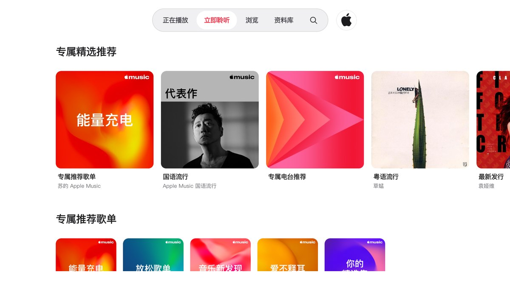
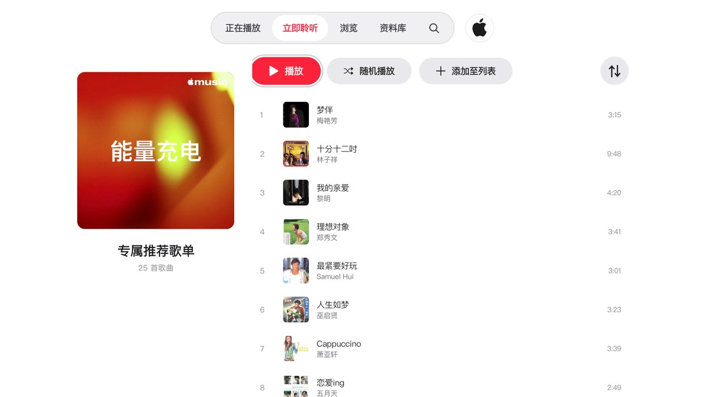
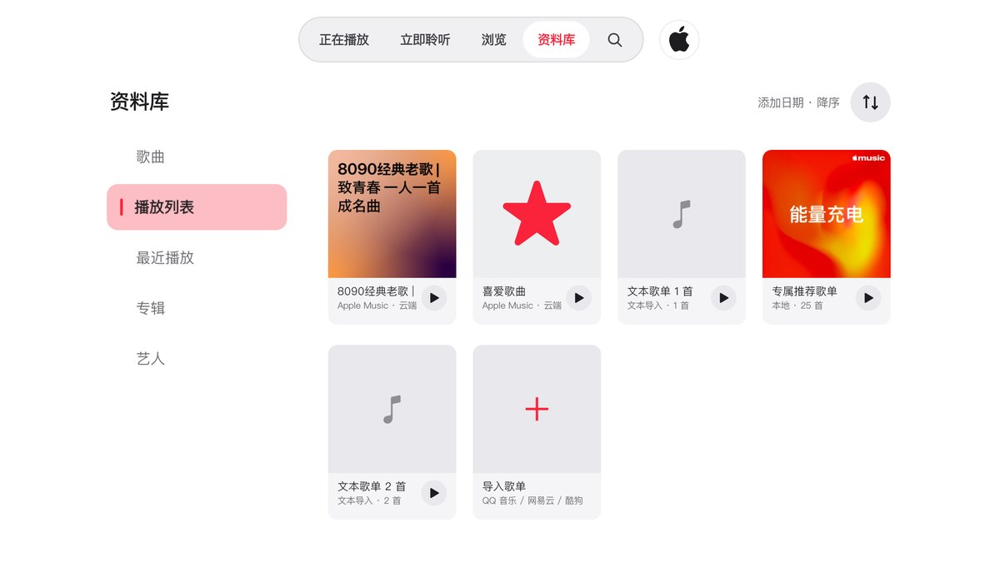
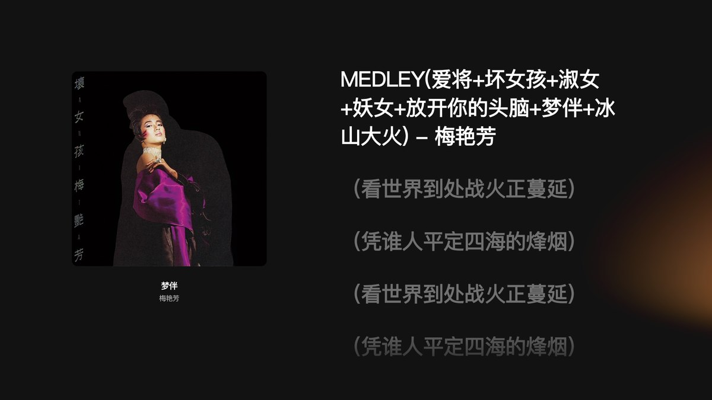

<div align="center">

# 🎵 看得清、切得顺的电视音乐台，被我改造成了 Apple Music 的伴侣

**Veil Music · 电视端音乐 App**

界面对标 Apple Music，播放走自研音源，整合歌单、歌词、封面等一套看起来自然、用起来顺手的部分。

[⬇️ 下载最新发布](https://github.com/veacon/veil.music/releases/latest) · [📜 看看更新了啥](https://github.com/veacon/veil.music/releases) · [🧩 技术档案（docs/README-technical.md）](docs/README-technical.md)

</div>



---

## 🎯 一句话介绍：它到底做什么

一款**给电视大屏做的 Apple Music 风格的音乐 App**：界面、功能、信息结构和 Apple Music 高度相似，播放则由**落雪（LX Music，自研音源脚本库在电视端解析）**提供，不经过任何人的服务中转。

所以你能得到：**Apple Music 的排版与质感** + **自己选音源的自由** + **不用登录、不用联网也能点起来**。

---

## 🧭 界面与功能一览（最新 2.3.6）

界面按「顶栏 / 页面内容 / 底部迷你胶囊」三段组织，遥控器方向键 + 触摸都能操作。

| 🎛 **播放** | 播放页全屏展示：封面、歌名艺人、歌词、进度与控制；点 **OK** 可进入**封面墙** |
| 🎵 **唱片墙（封面墙）** | 播放页按 **OK** 进入：满屏专辑封面与精选歌单交错铺排，选中卡片直接进入对应专辑/歌单，**按返回键退出** |
| 🎙 **音质** | 经典 128k / 高品质 320k / 无损 FLAC 三档，解码页随需切换 |
| 🗂 **资料库** | 收藏歌词、本地歌单、导入 QQ / 网易云 / 酷狗歌单、歌词收藏 |
| ☁️ **云端歌单** | 登录 Apple 账号后，云端歌单可在资料库展示；「**同步**」一键拉进本地资料库，可统一管理 |
| 🔍 **搜索** | 歌单 / 专辑 / 艺人：三平台文本歌词自动匹配 + 音源自动兜底 |
| 🌙 **界面** | 深色 / 浅色随**时间自动切换**（半小时粒度，可自定义深色时段）；界面、歌词、播放器设置页都能用繁体 |
| ⚙️ **设置** | 界面设置 / 应用设置 / 开发者选项（含「发现页」管理，方便复测） |
| ⬇️ **应用内更新** | 检查更新 → 选下载线路 → **同一界面显示进度、随时取消**；线路失败自动回退直连 |

### 主要界面长这样


<p align="center"><sub>浏览：新内容、新歌单推荐，收藏都在这</sub></p>


<p align="center"><sub>歌单详情：封面 + 曲目 + 时长，播放条就钉在最底下</sub></p>


<p align="center"><sub>资料库：本地入口的歌词、Apple Music 云端、歌单排在一块</sub></p>


<p align="center"><sub>播放页：封面墙入口（点 OK）、逐字歌词、封面高斯模糊</sub></p>

---

## 🧩 为什么把它做成这样（真实使用体验）

### 1. 🎛 遥控器体验是按「细节」打磨的

电视 App 最忌画面不动。这个版本把**引导页、焦点、快捷键**都按电视习惯做了：

- 页签、横竖都能当成**快捷键**，列表、底部都能点，按钮不会把光标顶丢
- 焦点在内容里一路往下，**到底后稳定落到底部迷你胶囊**，不会卡住
- 光标只走**导航壳 → 内容 → 胶囊**这一条动线，不会钻进看不见的层

### 2. 🎯 播放页入口够直接：封面墙

播放页点 **OK** 直接进入**封面墙** —— 满屏封面与精选歌单交错铺排，一眼能扫完。选中卡片进对应专辑/歌单，按返回键退出，随时回播放页。

### 3. 📝 歌词、封面、设置一体化

逐字歌词顺着光标走，五平台行级歌词自动合成逐字时间；封面用 Apple 的高清图片，电视上看着就是**干干净净的海报**；界面、日服、播放器配置页都可以转繁体。

### 4. 📱 手机扫码就能把歌单带进来

QQ 音乐 / 网易云 / 酷狗的歌单链接、或「复制歌名 - 歌手」的一段文本，在**手机浏览器**里扫一下码就进得来，比在大屏上一个个字打省一大截。

```
http://电视的IP:8080
```

这个页面里能点：音源脚本的**开/停**、刷新歌单、选择音质、看屏幕与 App 版本、调整应用设置。

### 5. ⬆️ 新版本加上速度，不再跳去下载页

应用内更新**开到应用内就能做**：**选线路**「检测更新 → 手动选线路」+ **8 个程序块安装**，并内置 3 条加速线路 + 1 条直连，选完记住线路、首次点「更新」直接进线路选择。支持国内网络（GitHub 镜像、直连兜底），**首次上手零配置**，**后续**国内网络也能**一行命令装完**。

### 6. 🌙 深浅色跟着时间走

设置 → 界面设置 → **定时切换深浅色**：可设定「深色开始 / 深色结束」，**按半小时**调整（如 19:30 → 07:00），跨零点也正确。每分钟检查一次，到点自动切换；关掉后完全交回手动选择。

---

## 🚀 能做什么（总表）

| | |
|---|---|
| 🎛 **播放** | 歌曲收录 / 歌单连续播放 / 歌词标记、快进、离线重新解析 |
| 🎵 **音质** | 经典 128k / 高品质 320k / 无损 FLAC 三档，解码页随需切换 |
| 🗂 **资料库** | 收藏歌词、本地歌单、导入 QQ / 网易云 / 酷狗歌单、歌词收藏 |
| ☁️ **云端歌单** | 登录后展示云端歌单，一键**同步**进本地资料库统一管理；编辑时云端在线歌单自动**置灰跳过**，避免误删 |
| 🎯 **封面墙** | 播放页按 OK 进入满屏封面墙，点卡片进专辑/歌单，返回退出 |
| 🔍 **搜索** | 歌单 / 专辑 / 艺人：三平台文本歌词自动匹配 + 音源自动兜底 |
| 🌙 **界面** | 深浅色**定时切换**（半小时粒度）+ 深浅色/日服/播放器界面都能转繁体 |
| ⬇️ **应用内更新** | 检查更新 → 选线路 → 原界面显示进度、可取消，线路失败自动回退直连 |
| ⚙️ **设置** | 界面设置 / 应用设置 / 开发者选项（「发现页」管理，可一键重看引导） |

### 三个页面长这样


<p align="center"><sub>浏览：新内容、新歌单推荐，收藏都在这</sub></p>


<p align="center"><sub>歌单详情：封面 + 曲目 + 时长，播放条就钉在最底下</sub></p>


<p align="center"><sub>资料库：本地歌词、Apple Music 云端、歌单排在一块</sub></p>

---

## 👥 适合谁用

- **遥控器党**：电视 + 遥控器就行，一手就能播，不用抬手点
- **不想各平台跳来跳去**：歌单随便拷，音源随便换，不挑平台
- **家里有 Apple Music 的人**：打开就是大屏海报风，不繁琐
- **收藏歌单的懒人**：把各个平台的歌单，统一收进一个本地资料库

---

## 🤝 三分上手

**1. 安装**

从 [Releases](https://github.com/veacon/veil.music/releases/latest) 下载 `Veil-Music-x.x.apk`，用 U盘插到电视上安装，或 `adb install -r Veil-Music-x.x.apk`（首次装电视需在系统设置里允许「未知来源」，需在系统设置里允许）。

**2. 打开就能用**

免登录也能听。想开**云端展示**，再去「设置」走一遍登录授权，再点一次「应用初始化」即可。

**3. 手机配置页（连接后打开一次）**

电视和手机连同一个 WiFi，手机浏览器打开 `http://电视的IP:8080`（IP 在配置页能看到），可以扫码导入歌单、换音源脚本、选音质、看版本、调应用设置。

**4. 遥控器快捷键**

| 按键 | 做什么 |
|---|---|
| 方向键 | 移动焦点（页签、页面里、按钮都是焦点） |
| 确认键 | 进入 / 播放 |
| 长按确认键 | 歌曲、歌词的关键菜单（收藏、加歌单、导入到列表） |
| **长按确认键** | 播放页：打开封面墙等 |
| 返回键 | 上一级 |

---

## 🤔 常见疑问（凡用必答）🪑

- **音源脚本是非官方产品**，**会失效**。失效了就去设置页换一条脚本就行，重要别依赖 App。
- QQ 音乐歌单太多只有约 28–88kbps 试听音质，会被限流，实际要听主要靠网页或客户端。
- 脚本有时没有稳定时长（约 20 分钟），暂停几秒再恢复会重新解析一次，这是正常行为。
- 文本输入的歌词还没有时长和高亮，只能按「歌名 + 歌手」匹配，命中率低于平台歌单。
- 「浏览」页是 Apple 的公开目录内容，**不随账号变化**，Apple 官方也不会做版本化。
- 部分音源脚本在电视上播放会黑屏，已下架，脚本列表是不推荐体验的。

---

## 🧰 开源与声明 📜

这个项目是**在你自己的家里机架里**的，来源只要清晰：

- **界面与素材来源**：[lavande16/Apple-Music-For-Android-TV](https://github.com/lavande16/Apple-Music-For-Android-TV)（**GPL-3.0**）。本项目基于它改造，UI 重构、Apple 目录接口、播放器音源自定义，**部分代码继承了 GPL-3.0**。
- **音频解码工具**：落雪（LX Music，自研音源框架），脚本由 [QuickJS](https://github.com/quickjs-ng/quickjs) 在电视端解析。
- **音源脚本**：内置 10 条来自社区的脚本（kulao / hyw / fish / 果酱 / Ciallo 等），部分来自 [lx-hunter](https://github.com/zlyon/lx-hunter) 的路线固定和精确筛选。**脚本版权归各自作者所有**，本项目只做社区内自用，不修改、不分割翻译任何版权。
- **歌词来源**：网络音乐、QQ 音乐、酷狗、酷我、网易云，使用 [lrclib](https://lrclib.net/) 兜底。
- **本程序不含任何音频文件**，不做 DRM 解密，不私下分发任何内容；所有歌曲由第三方音源在本地解析播放。

> 💡 仅面向学习交流与自用，欢迎你改善效果。若涉及平台或作者提出异议，请及时联系我处理相关内容。

技术细节（架构、实验数据、部署、发布流程）都在 🧩 [docs/README-technical.md](docs/README-technical.md)

---

<div align="center">

### 觉得有用的朋友，点个 ⭐ Star

码住你，或者你那边音源失效了，都欢迎去 [Issues](https://github.com/veacon/veil.music/issues) 聊一聊——你的反馈基本都会变成下一个版本的改进。✅

**收藏这篇文，等哪个电视盒子的伙伴想装了，回来找我就能找到它** 🎵

</div>
