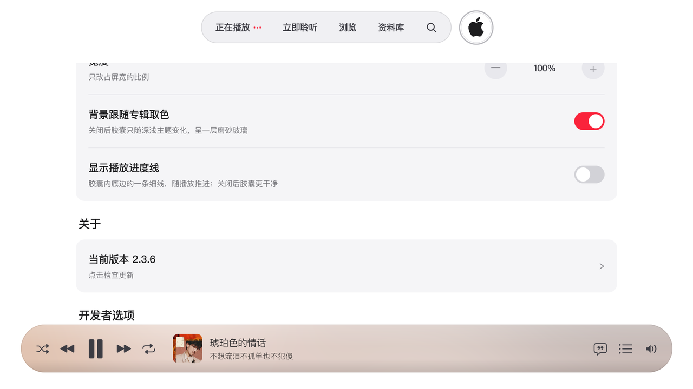
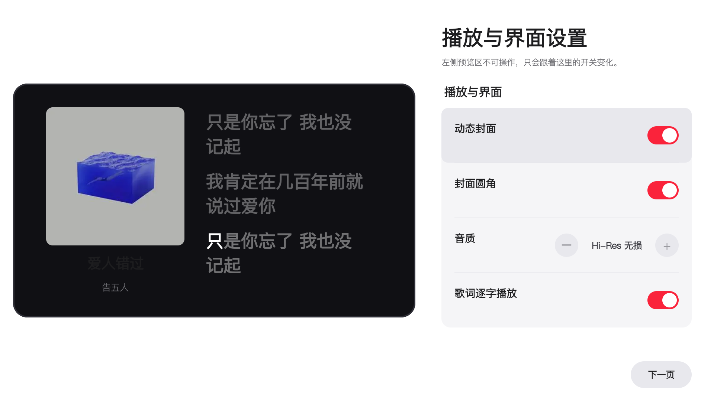
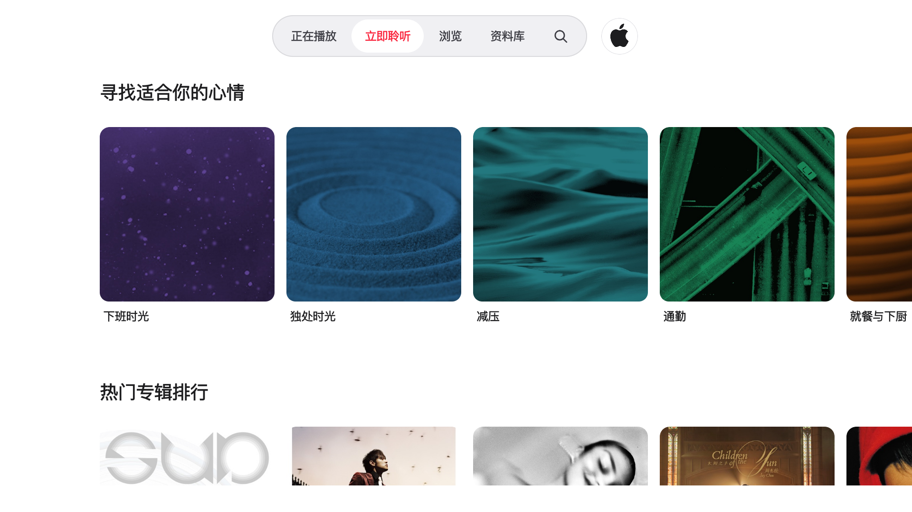
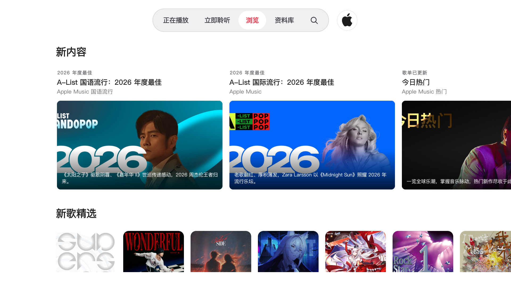
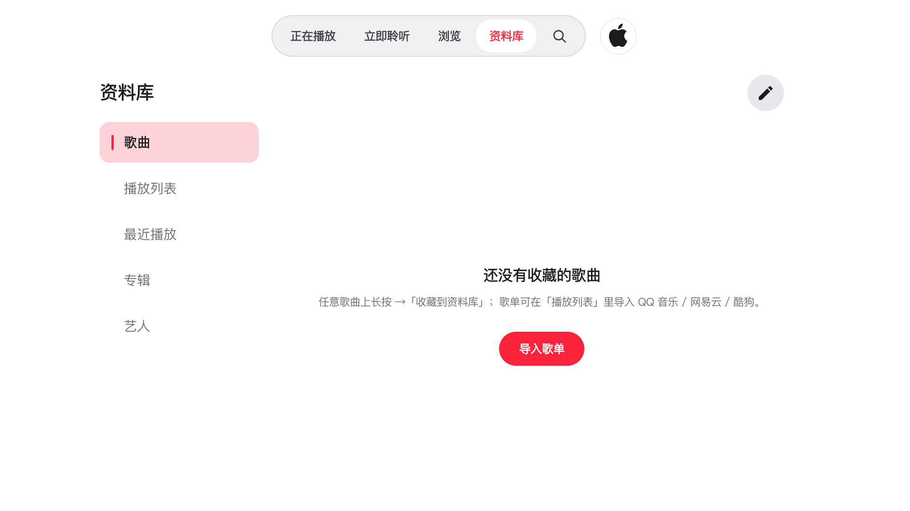
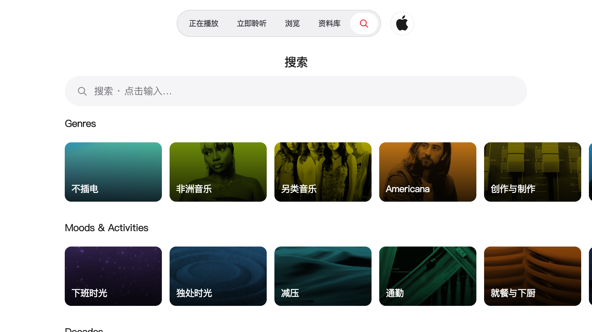
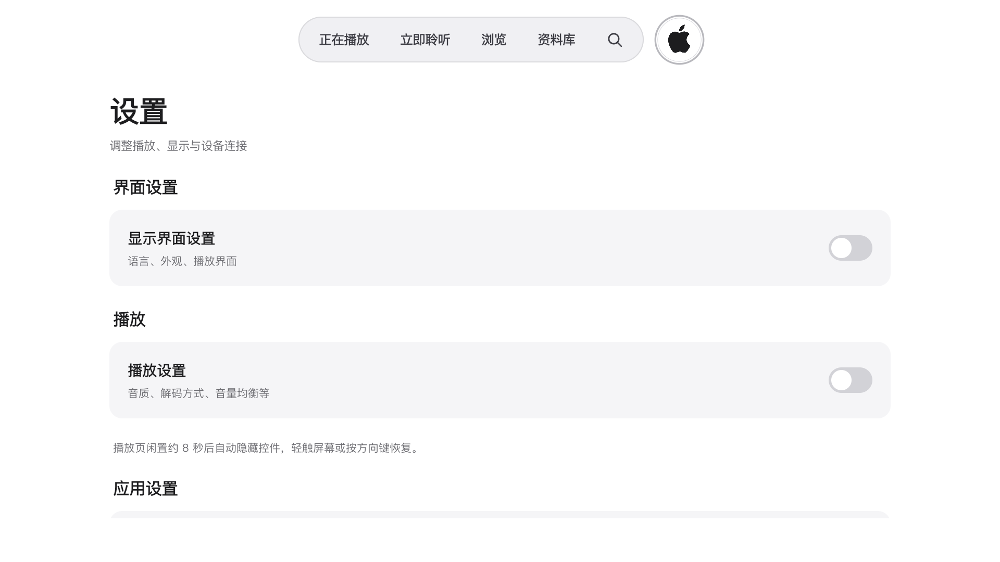

# 🎧 Veil Music

### 电视端的 Apple Music 风格播放器

播放走自研音源（落雪 LX 脚本，本地解析）· **免登录 · 断网也能听**

[⬇️ 下载最新版](https://github.com/veacon/veil.music/releases/latest) · [📜 更新日志](https://github.com/veacon/veil.music/releases) · [🧩 技术文档](docs/README-technical.md)

---

## 🎛 四个大屏亮点

**🎛 播放页** · 封面模糊铺底，歌词随播滚动，当前行**逐字亮起**（卡拉OK式）

**🎶 封面墙** · 选中封面按 OK，满屏封面铺开，点卡片进专辑 / 歌单，返回键退出

**🖥 全屏歌词** · 歌词按钮 →「全屏歌词」：封面缩到角落，歌词居中大字

**📌 音乐胶囊** · 离开播放页也有悬浮胶囊，切歌、看歌词随手就到（默认关闭）

---

## 📸 其他页面

| 页面 | 一句话 |
|---|---|
| 🐣 新手引导 | 左预览、右真设置，拨开关左边跟着变，光标不跑丢 |
| 🏠 首页 | 大屏海报风：心情卡片 ＋ 专辑排行 |
| 🗂 浏览 | 精选歌单、分类、艺人、专辑 |
| 📂 资料库 | 收藏 ＋ 本地歌单 ＋ Apple 云端歌单一键同步 |
| 🔍 搜索 | 分类浏览，三平台歌词匹配、音源兜底 |
| ⚙️ 设置 | 界面 / 播放 / 应用 / 实验性 / 维护 |

<table>
<tr>
<td width="50%"></td>
<td width="50%"></td>
</tr>
<tr>
<td width="50%"></td>
<td width="50%"></td>
</tr>
<tr>
<td width="50%"></td>
<td width="50%"></td>
</tr>
</table>

---

## 🎯 功能一览

| | |
|---|---|
| 🎛 播放 | 封面、歌词、进度、控制一体；当前行逐字扫光 |
| 🎶 封面墙 | 满屏封面，点卡片进专辑 / 歌单 |
| 🖥 全屏歌词 | 歌词居中大字，一键回分栏 |
| 📌 音乐胶囊 | 非播放页常驻悬浮条（实验性，默认关） |
| 🎵 音质 | 128k / 320k / 无损 FLAC 三档 |
| 🗂 资料库 | 收藏、本地歌单，导入 QQ / 网易云 / 酷狗歌单 |
| ☁️ 云端歌单 | Apple 云端歌单一键同步，编辑时自动跳过 |
| 🌙 界面 | 深浅色**按时间自动切换**，也能转繁体 |
| ⬇️ 更新 | 应用内检测 → 选线路 → 看进度、可取消 |

### 🌙 彩蛋：深浅色跟着时间走
设置 → 界面设置 → **定时切换深浅色**：设「深色开始 / 结束」，半小时粒度，跨零点也对。

### 📱 手机扫码导入歌单
歌单链接或「歌名 - 歌手」文本，手机扫个码就进来：`http://电视的IP:8080`

### ⬆️ 应用内更新
检测 → 选线路 → 同一界面看进度、随时取消；内置加速线路 ＋ 直连兜底。

---

## 🤝 三分钟上手

1. **安装**：从 [Releases](https://github.com/veacon/veil.music/releases/latest) 下 `Veil-Music-x.x.apk`，U 盘插电视装，或 `adb install -r`（首次需允许「未知来源」）
2. **打开就听**：免登录也能听；想看云端歌单，去「设置」登录一次
3. **手机配置页**：电视和手机同 WiFi，浏览器开 `http://电视的IP:8080`，扫码导入歌单、换音源、选音质、调设置

| 遥控按键 | 做什么 |
|---|---|
| 方向键 | 移动焦点 |
| 确认键 | 进入 / 播放；播放页**选中封面按确认进封面墙** |
| 长按确认键 | 收藏、加歌单、导入等菜单 |
| 返回键 | 上一级（封面墙、全屏歌词、详情页都能退） |

---

## 🤔 小提醒 🪑

- **音源脚本是非官方产品，会失效**——失效了去设置里换一条，别把重要依赖压在 App 上。
- 封面墙、全屏歌词、音乐胶囊都在，入口：播放页封面按确认 / 播放页歌词按钮菜单 / 设置 → 实验性功能（胶囊**默认关闭**，要自己打开）。
- QQ 音乐歌单多是试听音质、会被限流，要听主要靠网页或客户端。
- 脚本有时没有稳定时长（约 20 分钟），暂停几秒再恢复会重新解析，属正常。
- 文本输入歌词暂无时长与高亮，只能按「歌名 ＋ 歌手」匹配，命中率低于平台歌单。
- 「浏览」页是 Apple 公开目录，**不随账号变化**。

---

## 🧰 开源与声明 📜

- **界面与素材**：[lavande16/Apple-Music-For-Android-TV](https://github.com/lavande16/Apple-Music-For-Android-TV)（**GPL-3.0**）。本项目基于它改造，**部分代码继承 GPL-3.0**。
- **解码工具**：落雪（LX Music），脚本用 [QuickJS](https://github.com/quickjs-ng/quickjs) 在电视端解析。
- **音源脚本**：内置 10 条社区脚本，部分来自 [lx-hunter](https://github.com/zlyon/lx-hunter)；**版权归各自作者**，仅社区内自用。
- **歌词来源**：网络音乐、QQ 音乐、酷狗、酷我、网易云，[lrclib](https://lrclib.net/) 兜底。
- **本程序不含任何音频文件**，不做 DRM 解密，不私下分发内容。

> 💡 仅面向学习交流与自用。若涉及平台或作者异议，及时联系处理。

技术细节在 🧩 [docs/README-technical.md](docs/README-technical.md)

---

### 觉得有用，点个 ⭐ Star

音源失效了也欢迎去 [Issues](https://github.com/veacon/veil.music/issues) 唠两句——你的反馈基本都会变成下个版本 ✅

