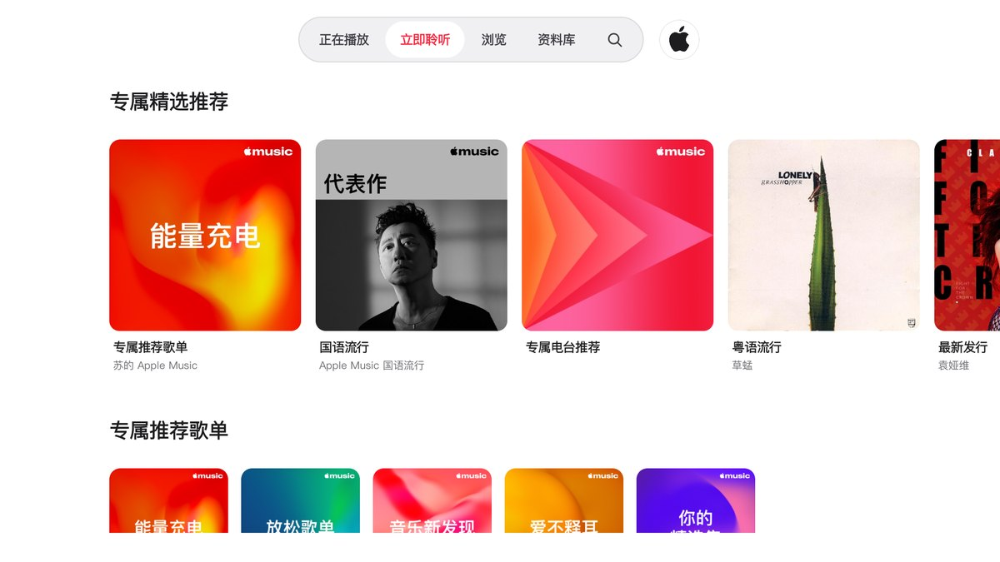
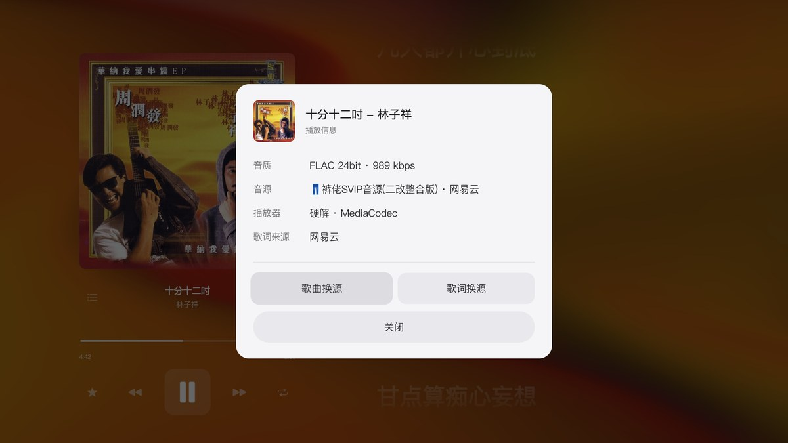
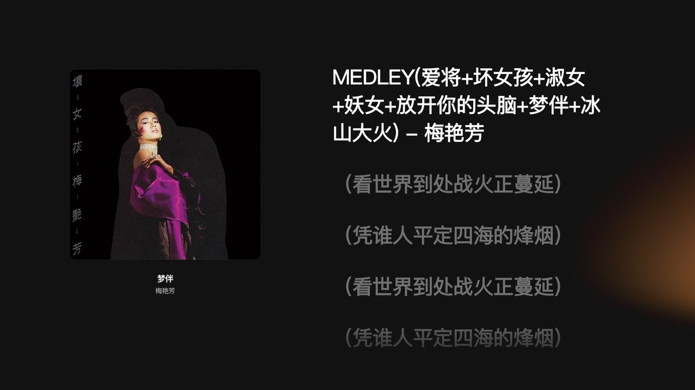
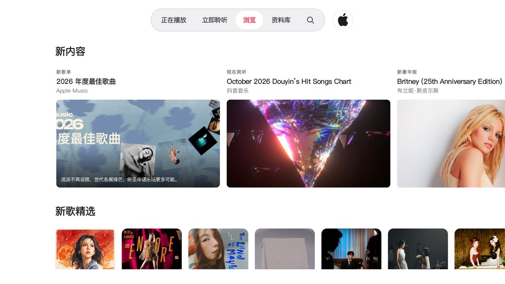
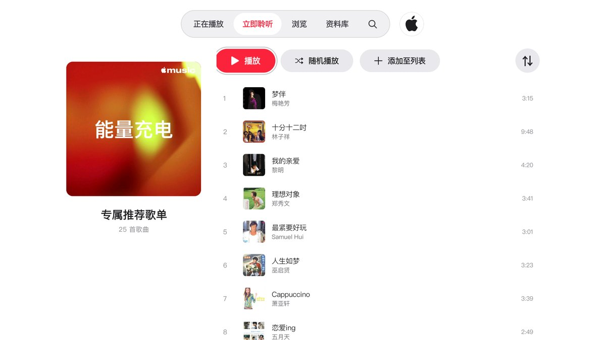
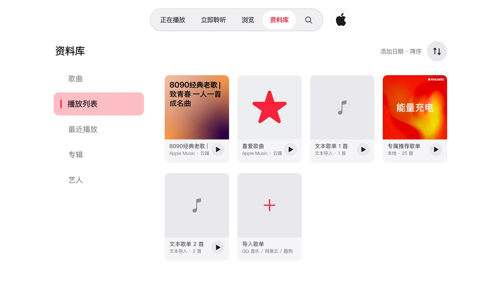

<div align="center">

# 🎧 家里那台吃灰的电视盒子，被我改成了「Apple Music 播放器」

**Veil Music · 安卓电视端音乐 App**

界面像 Apple Music｜音频走落雪音源｜遥控器友好｜不用充会员也能听整张专辑

[⬇️ 下载最新版](https://github.com/veacon/veil.music/releases/latest) ｜ [📦 看更新了什么](https://github.com/veacon/veil.music/releases) ｜ [🛠 技术档案](docs/README-technical.md)

</div>



---

## 先说结论：它到底是什么 🧐

一句话——**把 Apple Music 的壳，套在自家的音源上**。

界面、专辑信息、榜单、歌单这些「看起来的部分」来自 Apple Music 的公开目录；
真正发声的音频由**落雪（LX Music）自定义音源脚本在电视端内解析**，不经过任何人的服务器中转。

所以你会得到：Apple Music 的排版和气质 ＋ 自己音源的曲库和音质，装完即用，**不需要登录、不需要会员**。

---

## 我为什么留下它 ✨（真实使用感受）

### 1️⃣ 遥控器体验是认真做过的

电视 App 最怕「用遥控器点不动」。这个版本把焦点、滚动、返回键挨页走查过一遍：
顶栏、侧栏都是**焦点即选中**，空列表有「去浏览音乐」按钮兜底，弹窗不会把焦点卡死。

### 2️⃣ 播放页会「交代清楚」这首歌怎么来的

播放页按**菜单键**，直接看这一首的底细：音质、命中的音源、硬解还是软解、歌词来自哪个平台。
放不了、歌词不对？弹窗里就有 **歌曲换源** 和 **歌词换源**，一键换到下一个源，不用退出重来。





### 3️⃣ 歌词、封面、专辑一个都没缺

滚动歌词跟着节拍走，五平台级联匹配（网易云 → QQ → 酷狗 → 酷我 → 咪咕，lrclib 兜底），
封面用 Apple 的高清图，电视上看着是真舒服 📺

### 4️⃣ 手机扫码就能把歌单搬进来

QQ 音乐 / 网易云 / 酷狗的歌单链接，或者干脆把「歌名 - 歌手」贴一段文字，
在**手机浏览器**里粘进去就行，比拿遥控器一格一格敲舒服一万倍 👇

```
http://电视的IP:8080
```

这个页面还管着：音源脚本的导入/启停、音质档位、界面中英文、应用更新。

### 5️⃣ 更新走加速，不再转圈到天荒地老

应用内更新默认 **8 线程分片下载**，还内置了 3 条加速线路 + 1 条直连，点「更新」会先让你选线路，
选完记住。国内直连 GitHub 那种「等两分钟然后超时」的体验，这次是真修了。

---

## 能做什么 📋

| | |
|---|---|
| 🎵 **播放** | 整张专辑 / 歌单连续播放，断点续播、跨淡、失败自动重解析 |
| 🎚 **音质** | 标准 128k / 高品质 320k / 无损 FLAC 三档，设置页随时切 |
| 📚 **资料库** | 收藏歌曲、自建歌单、导入 QQ / 网易云 / 酷狗歌单、文本导入 |
| 🍎 **可选登录** | 登录 Apple 账号后，「立即聆听」变个性化推荐，资料库出现云端歌单（带真实封面） |
| 🔍 **搜索** | 搜歌 / 专辑 / 艺人，跨平台歌词与音源自动匹配 |
| 🌏 **中英双语** | 界面、日志、手机配置页都能切英文 |
| ⬆️ **应用内更新** | 检查更新 → 选线路 → 8 线程下载 → 校验签名 → 直接装 |

### 三个页面长这样


<p align="center"><sub>浏览：新内容、新歌精选，编辑部那味儿</sub></p>


<p align="center"><sub>歌单详情：封面 + 曲目 + 时长，播放键就在最顺手的位置</sub></p>


<p align="center"><sub>资料库：本地导入的歌单和「Apple Music · 云端」歌单排在一起</sub></p>

---

## 适合谁 🛋

- **客厅党**：电视 + 音响，遥控器一按就放，比投屏稳
- **折腾党**：不想被某个平台绑死，音源脚本可以自己导、自己换
- **家里有老人小孩**：打开就是大封面大按钮，不用教
- **数字音乐收藏癖**：把散落在各平台的歌单，统一收进一个本地资料库

---

## 三分钟上手 ⏱

**1. 下载安装**

去 [Releases](https://github.com/veacon/veil.music/releases/latest) 下 `Veil-Music-x.x.apk`，用 U 盘拷到电视装，
或者 `adb install -r Veil-Music-x.x.apk`。
（电视首次装第三方应用，需要在系统设置里允许「未知来源」）

**2. 打开就能用**

不登录也能听。想开个性化推荐，再去**手机配置页**绑一次 Apple 账号，绑完重启一次应用即可。

**3. 手机配置页（强烈建议打开一次）**

电视和手机连同一个 WiFi，手机浏览器输入 `http://电视的IP:8080`（IP 在设置页能看到），
可以导歌单、换音源脚本、切音质、看日志。

**4. 遥控器小抄 🎮**

| 按键 | 做什么 |
|---|---|
| 方向键 | 移动焦点（顶栏/侧栏都是焦点即选中） |
| 确认键 | 进入 / 播放 |
| 长按确认键 | 歌曲、歌单的右键菜单（收藏、加入队列、添加至列表） |
| **菜单键** | 播放页：看播放信息 + 歌曲换源 / 歌词换源 |
| 返回键 | 上一级 |

---

## 说点实话（已知限制）🙈

- 音源脚本是社区作品，**会失效**。失效了在手机配置页换一个脚本就行，不用重装 App。
- QQ 音乐源多数只给 28–38kbps 试听片段，会被码率校验挡掉，实际覆盖主要靠网易云、酷狗。
- 直链有有效期（约 20 分钟），暂停太久再拖进度会重新解析一次，这是正常行为。
- 文本导入的歌曲没有时长和封面，只能按「歌名 + 歌手」匹配，命中率低于平台导入。
- 「浏览」页是 Apple 的公共编辑内容，**不随账号变化**（Apple 官方也不做个性化）。
- 部分音源脚本在电视端跑会栈溢出，已排除，脚本列表是筛选过的。

---

## 开源与上游说明 📜

这个项目是**站在别人肩膀上**的，来源必须写清楚：

- **界面与元数据上游**：[`lavande16/Apple-Music-For-Android-TV`](https://github.com/lavande16/Apple-Music-For-Android-TV)（GPL-3.0）。
  本仓库基于它改造，UI 骨架、Apple 目录接口、播放器外壳都源自上游，**协议继承 GPL-3.0**。
- **音频解析协议**：落雪（LX Music）自定义源协议，脚本经由 [QuickJS](https://github.com/quickjs-ng/quickjs) 在电视端内执行。
- **音源脚本**：内置 10 条来自社区作者的脚本（kulao / hyw / fish / 星海 / Ciallo 等），
  部分经 [lx-hunter](https://github.com/zlyon/lx-hunter) 收录仓筛选复测。
  **脚本版权归各自作者所有**，本项目只做端内加载，不修改、不托管其服务。
- **歌词来源**：网易云音乐、QQ 音乐、酷狗、酷我、咪咕，以及 [lrclib](https://lrclib.net/) 兜底。
- **本项目不含任何音频文件**，不做 DRM 破解，不代理分发内容；所有音频由第三方音源在本地解析播放。

> ⚠️ 仅供学习交流与自用，请支持正版音乐。若相关平台或作者提出异议，会立即移除对应内容。

技术细节（架构、实测数据、踩坑、发布流程）都整理在 👉 [docs/README-technical.md](docs/README-technical.md)

---

<div align="center">

### 觉得有用的话，点个 ⭐ Star 吧

装好了、放起来了、或者哪个音源失效了，
都欢迎来 [Issues](https://github.com/veacon/veil.music/issues) 说一声 —— 你的反馈基本都会变成下个版本的更新说明 ✍️

**收藏这篇，等哪天电视盒子想折腾了，回来就能找到它** 🎧

</div>
